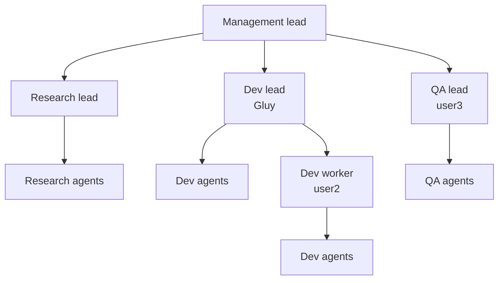
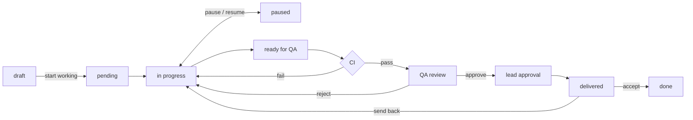
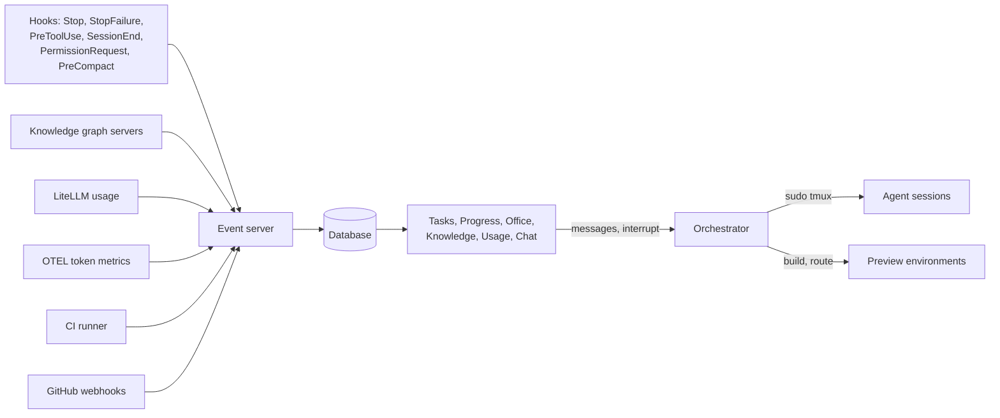

# AI Agent Office — System Design

> Implementation guideline. Last updated 2026-09-21.
> v3: GitHub origin, delivery reports, preview environments, usage tracking.

## Overview

The AI Agent Office is a self-hosted web app on a shared VPS where our 3-person team runs AI agents like a company. Each project is an office section with its own departments and knowledge graph. Anyone on the team can watch progress, talk to any agent, review finished work, and accept or send it back.

Goals:

- Run several projects in parallel, each with its own team of agents.
- Keep agents from creating git conflicts, reliably.
- Never make agents relearn project context when they respawn.
- Let all three of us monitor, interrupt, and direct any agent from one UI.
- Make reviewing an agent's work faster than doing the work ourselves.

That last goal is the one that decides whether this gets used daily. Preview links and good delivery reports are what keep it true; everything else is plumbing.

## Core architectural decisions

Four decisions shape everything else. Read these before the rest.

### 1. Uniform session model

**Every agent is its own `claude` process in its own tmux session.** We do not use Claude Code's Agent Teams teammate spawning.

Why: teammates spawned inside a lead session are hard to address from outside. In-process mode puts them all in one terminal behind an interactive panel; split-pane mode needs tmux, which the docs note works best on macOS. Making every agent a session gives one launch mechanism, one addressing scheme, and one messaging mechanism.

What we give up: the built-in shared task list and mailboxes. We rebuild those as our own task board and MCP messaging tools, which we needed anyway.

What we gain: per-role MCP servers and system prompts via `--agent`, permission prompts staying local, individually resumable sessions, and per-session model choice.

Cost: each session is a separate Node process. Budget several hundred MB each and enforce per-project caps.

### 2. GitHub is the origin

Each teammate has their own Linux user for credential isolation, and their own clone from GitHub. **Nobody shares a working tree.** No local bare repo.

```bash
# as gluy
git clone git@github.com:team/schedool.git ~/projects/schedool
# as user2
git clone git@github.com:team/schedool.git ~/projects/schedool
```

This removes the whole class of cross-user permission failures — `.git/index` ownership, `safe.directory`, `node_modules`, build output — and gives us pull requests, review comments, and off-box backup for free.

### 3. Shared state is services, not files

Anything all three users touch must not be a file on disk.

| Shared thing | Implementation |
|---|---|
| Knowledge graph | One server process per project running as `office`, reached over HTTP/SSE |
| Ownership registry | Table in the orchestrator's database, reached through MCP |
| Task board | Same database |
| Event log | Event server HTTP endpoint |

Hook scripts are the exception: read-only, owned by `office`, mode `755`.

### 4. Tasks belong to people

Every task has an `owner`, and a session only claims tasks owned by its user. **Do not build a shared auto-claim queue.** An idle desk is correct behavior, not a problem to optimize away. Only a human moves work between owners.

## Company structure



The example shows two accounts sharing Dev: Gluy leads, user2 works under him.

| Role | Does |
| --- | --- |
| Management lead | Takes tasks from humans, splits them by department, starts department leads when needed |
| Department lead | Plans, splits, assigns; starts agents; owns merges and decisions for its department |
| Worker session | Another account in the same department. Executes assigned tasks, starts its own agents, reports to its lead; never plans, reassigns, or merges |
| Agent | Does one task. Started on demand, shut down when done |

Every one of these is a tmux session started by the orchestrator. Several projects run in parallel as neighboring office sections.

## Project setup

### New project

1. Create the GitHub repo and each user's clone.
2. Start the knowledge graph server, seed with the brief and team setup.
3. Create the ownership registry and task board rows.
4. Register the run profile (see Delivery report).
5. Start the Management lead and add the section to the office.

### Importing an existing repo

All our current projects already exist, so this is the common path, not the exception.

1. Clone the repo for each user.
2. Run a one-off **analysis agent** over the codebase with a fixed brief: map modules and their responsibilities, entry points, build and test commands, conventions in use, external services, and anything surprising.
3. Write its output into the knowledge graph as the seed, tagged as derived from code rather than stated by a human.
4. A human reviews and pins the facts that matter ("we never use ORM X", "auth lives in `src/auth`").
5. Register the run profile.

Without this step the graph starts empty and every agent relearns the codebase, which defeats its purpose.

## Sessions: starting, addressing, messaging, stopping

### Starting

Only the orchestrator starts sessions, through `start_session(role, dept, owner, project, brief, backend, model)`. Leads call it; they never spawn directly, so per-project caps apply to every spawn.

```bash
sudo -u gluy tmux new-session -d -s schedool-dev-lead \
  'CLAUDE_CONFIG_DIR=/home/gluy/.claude claude --agent dev-lead'
```

Scoped sudoers, granting only tmux:

```
# /etc/sudoers.d/office
office ALL=(gluy)  NOPASSWD: /usr/bin/tmux
office ALL=(user2) NOPASSWD: /usr/bin/tmux
office ALL=(user3) NOPASSWD: /usr/bin/tmux
```

The orchestrator runs as `office`, never as root.

### Messaging in

```bash
sudo -u gluy tmux send-keys -t schedool-dev-lead "focus on the auth module" Enter
```

### Messaging out

The `Stop` hook fires when an agent finishes a turn and carries `last_assistant_message`. It POSTs to the event server, which pushes to the chat panel.

```json
{
  "hooks": {
    "Stop":             [{ "hooks": [{ "type": "http", "url": "https://localhost:8080/events/reply" }] }],
    "StopFailure":      [{ "hooks": [{ "type": "http", "url": "https://localhost:8080/events/failure" }] }],
    "PreToolUse":       [{ "hooks": [{ "type": "http", "url": "https://localhost:8080/events/tool" }] }],
    "PermissionRequest":[{ "hooks": [{ "type": "http", "url": "https://localhost:8080/events/permission" }] }],
    "SessionStart":     [{ "hooks": [{ "type": "http", "url": "https://localhost:8080/events/start" }] }],
    "SessionEnd":       [{ "hooks": [{ "type": "http", "url": "https://localhost:8080/events/end" }] }],
    "PreCompact":       [{ "hooks": [{ "type": "http", "url": "https://localhost:8080/events/compact" }] }],
    "PostModelSwitch":  [{ "hooks": [{ "type": "http", "url": "https://localhost:8080/events/model" }] }]
  }
}
```

**Revised since this was written.** Two corrections, both from `docs/spikes/001-hook-payloads.md`:

- **Scheme.** Every endpoint in the system is `https`, loopback included — decided deliberately, see
  the ticket index. `"type": "http"` above is the hook-config *keyword*, not a protocol: Claude Code's
  hook types are `http` and `command`, there is no `https` type, and only the URL scheme changes.
  TLS does not by itself fix the fact that hook POSTs carry no authentication or signature — anything
  that can reach the port can forge any event for any `session_id` — so ingest also binds loopback and
  carries a per-user token in the URL query string.
- **`SessionStart` cannot be an `http` hook.** Reproduced three times: it is never delivered to one,
  while a `command` hook registered in the same block receives it every time. It must be a `command`
  entry that POSTs to the event server. Every entry also needs an explicit `"timeout"` — the default is
  30 s and it stalls the turn.

Do not read the transcript file for the current turn — the docs state it is written asynchronously and may lag. Use `last_assistant_message`.

Live token-by-token streaming via the `MessageDisplay` hook is a later enhancement, not v1.

### Stopping and interrupting

A chat message queues until the agent's current turn ends, so chat alone cannot stop a wrong direction. Every agent needs two controls in the UI:

| Control | Mechanism | Use |
|---|---|---|
| Interrupt | `tmux send-keys -t <session> Escape` | Halt the current turn, keep the session |
| Kill | `tmux kill-session -t <session>` | Stop entirely; `SessionEnd` releases its locks |

Interrupt is the one you'll use constantly. Put it on the agent card, not buried in a menu.

## Stop and resume

A killed agent cannot save anything, so graceful and emergency stops are separate controls. Both can be scoped to one project or to everything.

| Control | What happens | Time | Resumable with |
|---|---|---|---|
| **Pause** | Interrupt every agent, instruct each to commit WIP and write a handoff, wait with a deadline, then kill | seconds | Full context |
| **Emergency stop** | Kill every session immediately | instant | Task state and last commit; the in-flight turn's reasoning is lost |

**On pause:**

- Each agent commits work-in-progress to its task branch and pushes, so nothing survives only in a working tree.
- Each writes a handoff node.
- File locks are **kept**, marked paused, and exempted from TTL expiry so nothing else claims them.
- Tasks move to `paused`.
- The orchestrator refuses `start_session` while paused, so a lead cannot quietly restart work.

**Emergency stop** skips the graceful steps — use it for runaway cost or something destructive. Locks are still kept and tasks still move to `paused`; only the current turn's thinking is lost.

**Resume** works at two levels, on the same machinery:

- **One task** — respawn its agent with the task brief, the handoff node, and its branch already carrying the WIP commit.
- **Everything** — resume all paused tasks in a project, respecting dependencies.

## Accounts, models, and usage

### Backends

Every session runs the Claude Code CLI; only the model behind it changes.

| Backend | How it connects |
| --- | --- |
| Claude subscription | The owner's own login, via `CLAUDE_CONFIG_DIR` |
| University Qwen | LiteLLM gateway, via `ANTHROPIC_BASE_URL` |
| Other providers (later) | Same gateway |

Any backend can serve any role. Qwen is not restricted to research or QA — if it does dev work well on a given project, use it there.

```yaml
# litellm config.yaml
model_list:
  - model_name: qwen-uni
    litellm_params:
      model: openai/<model-name-from-uni>
      api_base: https://<uni-endpoint>/v1
      api_key: os.environ/QWEN_UNI_KEY
```

```bash
ANTHROPIC_BASE_URL=https://localhost:4000
ANTHROPIC_AUTH_TOKEN=<litellm-key>
ANTHROPIC_API_KEY=""          # must be empty or it wins over the token
ANTHROPIC_MODEL=qwen-uni
claude --agent researcher
```

The `ask_model` MCP tool gives any session a second opinion through the same gateway.

Non-Claude models may handle long tool-use chains less reliably, so prove a model on lighter roles for a project before giving it that project's dev work. That's a per-project judgement, not a fixed rule.

### Model selection per agent

Three layers decide which model an agent runs on.

**1. Role default**, in project config:

```yaml
model_policy:
  default: sonnet
  roles:
    management-lead: opus
    dev-lead:        opus
    dev-agent:       sonnet
    researcher:      qwen-uni
    qa-agent:        sonnet
  escalate_to: opus     # lead may pick this for architecture, refactors, hard debugging
```

**2. The lead's per-task choice.** `start_session` takes a model and a one-line reason. A lead may escalate for work it judges hard.

**3. Human override**, any time. Every agent card carries a model chip; click it to change.

**Spawning is non-blocking.** The agent starts on the lead's chosen model and a notification reports what was picked and why. Work never stalls waiting for a human, but nothing happens unseen.

### Changing a model on a running agent

Two cases, and the UI must distinguish them:

| Change | Mechanism | Context |
|---|---|---|
| Within one backend (Opus ↔ Sonnet on the same login) | `tmux send-keys -t <session> "/model opus" Enter` | Kept, instant |
| Across backends (Claude ↔ gateway) | `ANTHROPIC_BASE_URL` is fixed at process start, so the session restarts | Preserved via handoff |

The cross-backend path reuses the handoff machinery: write a handoff node, kill the session, respawn with the new backend, inject the handoff as its opening context. Warn the user that this one takes a moment.

The `PreModelSwitch` and `PostModelSwitch` hooks log every change, so the Usage page attributes tokens to the right model and account after a switch.

### Usage page (per Claude login)

A dedicated page showing, for each of the three accounts:

- tokens consumed today and over the current rolling window, split by project and by role,
- number of active sessions right now,
- status: normal, approaching limit, or **rate limited**, with the reset time when known,
- the most expensive tasks of the day.

**Where the numbers come from.** Anthropic does not expose "quota remaining" programmatically, so we measure consumption ourselves and detect the hard stop:

1. **Consumption** — enable Claude Code's OpenTelemetry export (`CLAUDE_CODE_ENABLE_TELEMETRY=1` with an OTLP endpoint) and collect token metrics per session. Attribute each session to its account and task. If OTEL proves awkward, fall back to summing token counts from session transcripts.
2. **The hard signal** — when an account hits its limit, turns start failing. The `StopFailure` hook fires with the error, which usually carries a reset time. On that signal, mark the account rate limited, mark its desks blocked, and tell the humans.
3. **Warning threshold** — once you've watched real usage for a week, set a per-account daily token budget and warn at 80%. It's an estimate, not a reading from Anthropic, and the page should say so.

This page is what stops an account dying mid-task from looking like the agent got dumb.

### Cost control per task

Every task accumulates token usage and turn count, shown on its card.

**Circuit breaker:** if a task exceeds its token or turn budget, the orchestrator interrupts the agent, marks the task `needs attention`, and notifies a human. This catches silent loops as well as runaway cost. Defaults are per project, overridable per task.

## Task lifecycle

Tasks live in our database, managed through our own MCP tools. Claude's `TaskCreated` and `TaskCompleted` hooks run as a secondary net, but the server is authoritative.

### States



`paused` is where every interruption lands — manual pause, crash, circuit breaker, or rate limit — so one Resume button recovers all of them.

### Planning before execution

Nothing runs until a human says so. Planning produces a **draft batch** that sits inert until promoted.

1. **Talk to Management.** During planning it runs read-only: it can read the repo and the knowledge graph, and may spawn a research agent, but it cannot call `start_session` for workers or touch files. The orchestrator enforces this.
2. **It drafts the breakdown** — for each task: title, department, owner, file scope, dependencies, proposed model, acceptance criteria.
3. **You review the batch** in the Draft column. Reassign owners, change scope, split or merge, fix dependencies, delete, add.
4. **Start working** promotes the batch: `draft → pending`, leads spawn, agents begin.

You can plan a new batch while earlier work runs, so planning is a conversation you open anytime rather than a project-wide mode.

### Dependencies

Tasks carry `blocked_by`, a list of task ids. `claim_task` refuses a task whose dependencies aren't done. When a task closes, the orchestrator unblocks its dependents and notifies their owners' leads.

Without this, Management cannot express "build the API before the UI that consumes it," and agents start work that can't finish.

### The three test stages

| Stage | Who | Where | Authority |
|---|---|---|---|
| 1. Dev self-test | Dev agent | Its own clone | Fast feedback, not authoritative |
| 2. CI run | Orchestrator, on push | Clean clone, fresh checkout and install | Authoritative pass/fail |
| 3. Final test | QA agent | Its own clone, against acceptance criteria | Closes the task |

A dev calling `complete_task` moves the task to **ready for QA**, never straight to done.

The CI clone does a clean checkout and fresh dependency install every run, so a pass is reproducible rather than an artifact of one agent's environment.

### MCP task tools

- `claim_task(task_id)` — checks owner match, dependency state, and file-scope overlap, then locks
- `complete_task(task_id, summary, learning)` — requires a learning entry, requires rebase onto current `main-dev`, pushes the branch, opens the PR, triggers CI
- `approve_task(task_id, notes)` — QA only
- `reject_task(task_id, reason)` — returns to in progress
- `deliver_task(task_id)` — lead approval, squash-merges, generates the report, notifies humans

## Git workflow

| Branch | Holds |
|---|---|
| `main` | Accepted, released state |
| `main-dev` | Integration. Every approved task lands here so work continues |
| `task/<id>-<slug>` | One per task, branched from `main-dev` |

**Squash-merge each task into `main-dev` as a single commit**, and record the resulting SHA on the task row. One task, one commit, one revert. The task branch is never deleted, so its full history stays recoverable.

### Reverting a delivered task

```bash
git revert <merge-sha>
git push origin main-dev
```

A forward commit, not a history rewrite. No force-push, nothing lost, and every commit that landed afterwards is untouched. In the UI this is the **Send back** button on the delivery report: it reverts, reopens the task with your comment, and notifies the owner's lead.

Two cases to build for:

- **The revert conflicts** with a later change to the same lines. Don't fail silently — create a revert task assigned to the Dev lead with the conflict attached.
- **In-flight tasks built on reverted code** will meet it on their next rebase. After any revert, notify the leads of in-flight tasks whose file scope overlaps the reverted files.

`main-dev` merges into `main` when you decide a batch is good.

## Conflict prevention

Every task declares the files or modules it touches. Overlapping active tasks are refused.

| Guard | Blocks |
| --- | --- |
| Ownership registry (per project, in the database) | Records which active task owns which files |
| `claim_task` | Claims overlapping an active task, wrong owner, or unmet dependencies |
| `PreToolUse` hook | Edits to files owned by another active task |
| `complete_task` | Completion without rebase, passing tests, or a learning entry |
| `TaskCreated` / `TaskCompleted` hooks | Secondary net behind the MCP tools |

Hooks block by exiting with code 2, which returns feedback to the agent instead of letting the action through.

**Lock release**, three ways, because no single one is reliable:

1. Normal release on `complete_task`.
2. `SessionEnd` hook releases any locks held by that session.
3. TTL with a heartbeat refreshed on `PostToolUse`, for hard crashes where no hook fires.

The registry prevents concurrent edits, not divergence. Short-lived branches and the rebase check in `complete_task` handle the rest.

## Permissions

Agents should never block on a prompt during normal work.

1. **Pre-approve per role** in each role's settings allowlist.
2. **Detect the rest** via the `PermissionRequest` hook, which marks the agent blocked in the UI and names what it asked for.
3. **Human resolves** by opening that tmux session directly.

Do not build keystroke injection to answer prompts. Timing against a live TUI is fragile.

## Knowledge graph

One graph server per project, so new or respawned agents start with what the team already knows.

**Contents:** modules, files, APIs, decisions and their reasons, research findings, bugs, conventions, owners, and tasks. Linked by relations, with a source and timestamp on every fact.

**Injection:** inject small, let agents search. At `SessionStart` an agent receives the project summary, pinned facts, its role's standing context, and the handoff node if it is replacing someone. Everything else it pulls through `search`, `get_entity`, and `get_related`.

**Handoff:** an agent writes a handoff node (state, next steps, open questions) on three triggers — `PreCompact`, `SessionEnd`, and periodically every N tasks, so a hard crash still leaves something behind.

**Curation:** agents add; only leads edit or delete. Duplicate and contradiction checks on write. Old decisions marked superseded, never deleted.

**Storage:** Knowledge Graph Memory MCP server, one HTTP server per project. Move to Kùzu or SQLite behind the same tools if it outgrows that.

## Delivery report

When the lead approves, the orchestrator assembles a report and notifies the humans. Different parts come from different sources, deliberately.

| Part | Written by |
|---|---|
| What was asked | The original task |
| What changed, in plain language | Dev agent's `complete_task` summary |
| Files, diff stat, commits, branch, merge SHA | Orchestrator, from git |
| Test results | CI stage 2 output |
| How to verify | QA agent — concrete steps, e.g. "enter a wrong password three times, expect the lockout banner" |
| Preview link | Orchestrator (see below) |
| How to pull and run | Per-project run profile, not the agent |
| Known gaps | Dev agent |
| Token cost | Orchestrator |

**Run instructions come from a stored template, not agent generation.** An agent inventing setup commands will eventually hallucinate one.

```yaml
run_profile:
  install: pnpm install
  dev: pnpm dev
  test: pnpm test
  url: http://localhost:5173
```

Rendered with the branch filled in, plus only the deltas the agent actually introduced:

```bash
git fetch origin
git checkout task/42-auth-lockout
pnpm install
pnpm db:migrate     # added by this task
pnpm dev
# open http://localhost:5173/login
```

The two `http://localhost:5173` URLs above are deliberately **not** `https`. They belong to the
*managed project's own* dev server on the reviewer's machine, not to the office — a reviewer running
`pnpm dev` gets whatever scheme that project's dev server binds, and declaring `https` here would
print a link that does not resolve. The office's own rule (https everywhere, loopback included)
governs the office's endpoints; where a project *is* exposed to the team, that is the preview
environment below, and it is `https`.

The report is also posted as the pull request body, so it lives where you already look.

**Acceptance loop:** accept closes the task; send back reverts the merge and reopens it with your comment.

## Preview environments

The highest-value feature in the system. Without it, every review costs five minutes of local setup and you will stop reviewing.

When a task reaches QA review, the orchestrator builds and starts the branch on the VPS and puts the link in the report and on the task card:

```
Preview: https://schedool-task42.office.local:8412
```

Implementation:

- Each project's run profile includes a preview recipe — ideally a `docker compose` file so builds are isolated and teardown is clean.
- One container set per active preview, port assigned by the orchestrator, routed by the reverse proxy on a per-task subdomain.
- Torn down when the task is accepted, or after an idle timeout.
- Cap concurrent previews per project; they cost more RAM than agents do.
- App logs from the preview stream into the task detail page, so a failing preview is debuggable without SSH.

## Web UI

| Page | Shows |
| --- | --- |
| **Lobby** | Outside every office. Office cards with status, active agents, open tasks, your role, last activity. Create office, pending invitations |
| **Members** (per office) | Member list with roles, pending invites, generate and revoke invite links. Admin only |
| **Tasks** | Board with four columns: Draft, To do, In progress, Done. Pipeline states appear as chips inside In progress (in progress · paused · ready for QA · CI · QA review · awaiting lead). Draft holds an unstarted batch with a Start working button. Filter by project, owner, department. Cards show title, owner, department, model, owned files, elapsed time, token cost |
| **Task detail** | Full activity log, chat with the assigned agent, diff summary, CI output, preview link, app logs, delivery report |
| **Progress** | Per project and department: current work, status by owner, successes, problems, blocked agents, **Needs your review** |
| **Office** | Pixel office (Pixel Agents fork): lead desks, worker desks labeled by owner, agents grouped under each, each labeled with its model |
| **Spawn feed** | Every agent started, with its role, owner, model, and the lead's reason for that model. One click to change the model |
| **Knowledge** | Browse and search the graph, see recent additions, add, edit, pin facts |
| **Usage** | Per Claude login: consumption, active sessions, rate-limit status, most expensive tasks |
| **Company overview** | Every project's health, open problems, idle desks, blocked accounts, gateway spend. Carries the Pause and Emergency stop controls, per project and global |

**Chat panel** slides in from any page. It shows the agent's recent actions, its replies from the `Stop` hook, a model chip you can click to switch, an Interrupt and a Kill button, and a blocked banner when a permission request is outstanding.

## Discord

Discord is the notification and remote-control surface. It's also the cheapest way to reach the system from a phone without building a mobile UI.

### Outbound (v1)

A webhook per office posts to a channel:

| Event | Message |
|---|---|
| Task delivered | Title, who built it, preview link, link to the report |
| Agent blocked | Which agent, what it's waiting on |
| Account rate limited | Which account, reset time if known |
| Circuit breaker tripped | Task, token or turn count |
| CI failed | Task, failing step, log link |
| Emergency stop | Who triggered it, scope |

Build this behind a notification interface with Discord as one implementation, so another channel can be added later without touching the callers.

### Bot (v2)

A Discord bot for control from anywhere:

- `/status [project]` — active agents, open tasks, blocked items
- `/tasks [project]` — the board, summarised
- `/approve <task>` and `/sendback <task> <reason>`
- `/pause [project]` and `/resume [project]`
- `/say <agent> <message>` — instruct an agent

Commands map to the same API the web UI uses, and carry the same role checks. A Discord identity must be linked to an office member before any command works; unlinked users get nothing.

### Per-task threads (v3)

Each delivered task opens a thread. The report is the first post, discussion happens in the thread, and replies route back into the task's comment log. Sending it back from the thread triggers the same revert as the web UI.

## Review comments become tasks

A GitHub webhook on pull request review comments creates a task assigned to the same owner, with the comment as the brief and the commented file as its scope. This closes the loop from review back into the system, instead of you retyping the fix request into Management.

## Lobby, membership, and access

### Lobby

The page outside every office. It lists the offices you belong to as cards — project name, status (planning, working, paused), active agents, open tasks, your role, last activity — plus a Create office button and any pending invitations.

### Two separate concepts

**Office membership** is what a person may do in the UI. **An agent account** is a Claude login on the VPS that can own tasks and run sessions.

They are not the same thing. An invited editor with no agent account can chat with agents, approve work, and stop things, but no tasks can be assigned to them until an admin links them to an account. Keep these separate in the schema.

Likewise, **office admin is not server admin**. The server admin runs the VPS and controls Linux users, Claude logins, gateway keys, and secrets. An office admin controls one office.

### Roles

| | Viewer | Editor | Admin |
|---|:--:|:--:|:--:|
| See tasks, progress, office, knowledge, reports, chat history | ✓ | ✓ | ✓ |
| Chat with agents, interrupt, kill | | ✓ | ✓ |
| Plan batches, start working, assign tasks | | ✓ | ✓ |
| Approve delivery, accept or send back | | ✓ | ✓ |
| Change models, pause, resume | | ✓ | ✓ |
| Invite, remove members, change roles | | | ✓ |
| Edit project config: run profile, model policy, caps, secrets | | | ✓ |
| Delete office | | | ✓ |

### Invite links

An admin generates a link with a role baked in.

- Expiry, default 7 days.
- Single-use or multi-use.
- Revocable, with pending invites listed for the admin.
- Token stored hashed.
- Recipient signs in to accept.
- Every invite records who issued it.

**Invites default to viewer.** Creating an editor or admin link shows a warning, because an editor can direct agents to do anything in the repo, and a link shared in a chat app travels further than intended.

### Instructing another person's agent

Any editor can chat with, interrupt, or kill any agent, including agents running on another member's Claude account. This is intentional: an agent stuck at 2am shouldn't wait for its owner to wake up.

Two constraints on it:

**It spends the owner's quota.** An agent on user2's account consumes user2's subscription limit no matter who directs it. Cross-owner instructions must be visible to the owner in their agent's history and reflected on the Usage page, not buried.

**Instruction is not assignment.** Nudging a running agent is ordinary collaboration. Moving tasks onto someone else's account is a separate, deliberate, visible action. Keep the two apart in the UI.

The distinction that matters: a teammate nudging a colleague's agent is normal. One person routinely driving all the work on someone else's account makes that account a second seat for them, which is what the owner-scoped design exists to avoid. Each person should be the one whose work actually runs on their account.

**Office setting:** *anyone can instruct any agent* (default for a small trusted team) or *owner and leads only*. The setting matters because an invited editor with no agent account of their own could otherwise spend every member's quota.

### Removing a member

Access is revoked immediately and their UI sessions are killed. If they had an agent account with active tasks, the admin is prompted to reassign or pause those rather than leaving them orphaned.

### Deleting an office

**Deleting an office never deletes the git repo.** It kills sessions, tears down previews, and drops the knowledge graph, task history, and event log. The code stays.

It is a soft delete with a 30-day grace period, and requires typing the office name to confirm.

### Working together

- App-level login with per-user identity, behind the reverse proxy. Identity is required, since every message, approval, and acceptance is attributed.
- Messages are labeled by sender and queued in order.
- Presence shows who is talking to which agent.
- Web sockets keep every screen in sync.

## Reliability

| Failure | Detection | Response |
|---|---|---|
| Turn ends on an API error | `StopFailure` | Mark the agent blocked, show the error |
| Account hits its usage limit | `StopFailure` with a rate-limit error | Mark the account rate limited on the Usage page, block its desks, notify humans |
| Session exits | `SessionEnd` | Release locks, mark the desk empty |
| Hard crash or OOM | Supervisor polling tmux | Mark `paused`, keep locks, offer Resume |
| Runaway task | Token or turn budget exceeded | Interrupt, mark `paused`, notify |
| Preview won't build | Build exit code | Show build log on the task page, leave the task in QA review |

Hooks catch clean failures; polling catches everything else.

## Secrets

The orchestrator injects project secrets as environment variables at session launch, from a store readable only by `office`. Secrets never land in a clone, a repo, or a user's home directory. Preview containers get the same injection.

## Backups

Code lives on GitHub already. Nightly cron pushes the rest to a private GitHub repo:

- a snapshot of each knowledge graph,
- the orchestrator database dump.

## Data flow



## Stack

| Layer | Choice |
| --- | --- |
| Engine | Claude Code CLI, one tmux session per agent, started with `--agent <role>` |
| Backends | Claude subscription logins via `CLAUDE_CONFIG_DIR` + LiteLLM gateway |
| Orchestrator | Our service, as `office`: project setup, session lifecycle, supervisor, CI runner, preview manager, message routing, caps |
| Session tools (MCP) | `start_session`, `message_session`, `report_progress`, `ask_model` |
| Task tools (MCP) | `claim_task`, `complete_task`, `approve_task`, `reject_task`, `deliver_task` |
| Graph tools (MCP) | `search`, `get_entity`, `get_related`, `add_observation`, `add_relation`, `write_handoff` |
| Knowledge | Knowledge Graph Memory MCP server, one HTTP server per project |
| Code host | GitHub — origin, PRs, review webhooks, backup |
| Previews | Docker Compose per branch, routed by the proxy |
| Metrics | Claude Code OpenTelemetry export, transcripts as fallback |
| Notifications | Discord webhook, then a bot for remote control |
| Backend | Event server + Postgres + web sockets |
| Frontend | Tasks, Progress, Office (Pixel Agents fork), Knowledge, Usage, plus chat |
| Access | Reverse proxy (Caddy or Nginx) + app-level login, per-office roles, hashed invite tokens |

## Reuse vs. build

**Reuse:** Claude Code, Pixel Agents, Knowledge Graph Memory MCP server, LiteLLM, tmux, Docker Compose, Caddy or Nginx, GitHub.

Read every hook script in forked code before installing it. Hooks run shell commands on a box holding three people's logins.

**Build:** orchestrator (setup, lifecycle, supervisor, CI, previews, routing, caps), the three MCP servers, role definitions, hook scripts, ownership registry, graph seeding and handoff flow, event server and database, all six UI pages, chat bridge, auth and presence, secret injection, usage collection, GitHub webhook handlers.

## Build order

1. **Spine.** One project, Claude only, Management and one Dev lead as tmux sessions. Orchestrator starts and messages them. `Stop` hook returns replies. Interrupt button works.
2. **Coordination.** Task board with draft state and dependencies, planning flow with Start working, ownership registry, `claim_task` and `complete_task`, `PreToolUse` guard.
3. **Tasks page and chat panel.** The UI becomes usable. Pause, emergency stop, and resume land here too — build them before agents ever run unattended.
4. **Git workflow.** Branches, PRs, squash merge, revert, delivery report.
5. **Knowledge graph.** Server, injection, handoff. Then the import flow for an existing repo.
6. **QA gate and Discord.** CI clone, three stages, QA role, acceptance loop, Discord webhook notifications.
7. **Reliability and usage.** Supervisor, `StopFailure`, lock TTL, OTEL collection, Usage page, circuit breaker.
8. **Preview environments.**
9. **Second account and access control.** Worker sessions, per-user clones, sudoers, presence. Lobby, per-office roles, invite links, member management.
10. **Office tab.** Pixel visualization.
11. **Gateway and model control.** LiteLLM with university Qwen, model policy per role, spawn feed, live model switching.
12. **Scale out.** Multiple projects, Discord bot and task threads, review-comment webhook, backups, caps tuning.

Steps 1–3 carry the risk. If the chat bridge doesn't work, nothing above it matters, so prove it before building further.

## Open questions

- [ ] Which project is the first test (ScheDool, PseudoFlow, or a throwaway repo)?
- [ ] University Qwen: model name, endpoint format, off-campus access?
- [ ] VPS specs: RAM for N concurrent `claude` processes plus preview containers?
- [ ] Does `CLAUDE_CONFIG_DIR` keep two logins authenticated at once? (verify before relying on it)
- [ ] Does Claude Code's OTEL export carry usable per-session token counts, or do we sum transcripts?
- [ ] Who owns which department by default?
- [ ] Default caps: max agents per project, max concurrent previews, idle timeout, lock TTL, per-task token budget?

## References

- [Hooks reference](https://code.claude.com/docs/en/hooks) — all hook events and payloads
- [Orchestrate teams of Claude Code sessions](https://code.claude.com/docs/en/agent-teams) — why we avoid teammate spawning
- [Pixel Agents](https://github.com/pixel-agents-hq/pixel-agents) — pixel office visualizer (MIT)
- [paulrobello/claude-office](https://github.com/paulrobello/claude-office) — alternative office with a command center
- [LiteLLM](https://docs.litellm.ai/) — gateway with an Anthropic-compatible endpoint
- [Bifrost](https://github.com/maximhq/bifrost) — faster Go alternative to LiteLLM
