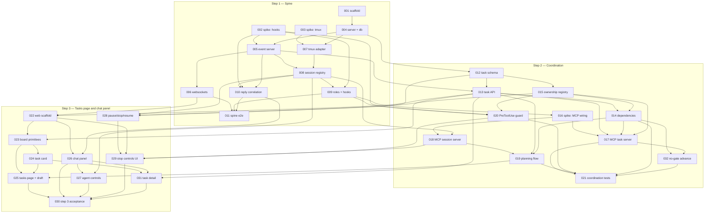

# Implementation tickets — build steps 1–3

Thirty-one tickets covering the first three build steps of [the system design](../ai-agent-office-design.md):

1. **Spine** — one project, Management and one Dev lead as tmux sessions, replies via the Stop hook, interrupt working.
2. **Coordination** — task board with draft state and dependencies, planning flow, ownership registry, `claim_task` / `complete_task`, the PreToolUse guard.
3. **Tasks page and chat panel** — the UI becomes usable, plus pause, emergency stop and resume.

The design says steps 1–3 carry the risk: if the chat bridge doesn't work, nothing above it matters. Three of these tickets are research spikes for exactly that reason, and they gate the tickets that depend on their findings.

## Conventions

**One file, one ticket.** No file appears in two tickets' scopes — see the [file ownership map](#file-ownership-map). Three structural conventions make that possible instead of merely aspirational:

| Convention | Established in | Lets a later ticket |
| --- | --- | --- |
| Server routes autoloaded from `packages/server/src/features/*/routes/` | 005 | add an endpoint without editing a route registry |
| Event handlers collected from `packages/server/src/features/*/handlers/` | 005 | add per-event behaviour without editing the dispatcher |
| Hook config merged from `config/hooks/fragments/` | 009 | add a hook entry without editing the settings template |
| Numbered SQL files in `db/migrations/` | 004 | add a table without editing a schema file |
| UI overlays collected by `import.meta.glob` from `src/features/*/overlay.tsx` | 022 | add a slide-in panel without editing the app shell |
| File-based routes in `packages/web/src/routes/` | 022 | add a page without editing a route table |
| MCP servers mounted by `mountMcpServer` from `features/mcp/protocol.ts` | 017 | add an MCP server as one route file, with no protocol code |

**Layout: one folder per feature, plus `core/`.** The server is organised as vertical slices —
`packages/server/src/features/<name>/` holds that feature's modules, its `routes/` and its
`handlers/` together — over a `packages/server/src/core/` holding only what every feature calls:
the Fastify app, the config reader, the database pool. `deploy/` follows the same shape, one
directory per deployment concern (`dev/`, `host/`, `vps-sim/`).

The features in steps 1–3 are `events`, `realtime`, `orchestrator`, `tasks`, `locks`, `chat`,
`planning` and `permissions`. A ticket adding a genuinely new concern adds a folder; it does not
need permission from this file to do so.

**The autoloaded unit is the file, not the feature.** This matters for one-file-one-ticket: four
tickets add endpoints to `features/tasks/` (013 tasks, 014 dependencies, 017 actions, 032
advance), so a single `routes.ts` per feature would force them onto one file. Each owns its own
file inside the shared `routes/` directory instead.

**Maintenance files.** Two paths belong to no ticket because they fix gaps no ticket owned.
`db/migrations/0013_events_project_fk.sql` gives `events.project_id` an `on delete cascade` it
never had — harmless while the column was always null, and a hard blocker on deleting any project
the moment events started carrying one. It is numbered 0013 because 0008–0012 are already claimed
by unwritten tickets. `scripts/dev-cert.mjs` generates the local TLS pair that `.env.example`
points at but nothing created; on a real host `deploy/host/provision-host.sh` does the same job.

**Manifest exception.** Dependency additions to an existing `package.json`, appended lines in `.env.example`, and a new `loadXConfig()` section appended to `packages/server/src/core/config.ts`, are append-only and are *not* part of any ticket's file scope. Every other file is owned. Editing an existing config section, the shared readers, or `ConfigError` still belongs to ticket 004.

**Reopening a closed ticket beats inventing an owner for its files.** Where a later finding needs a
change inside a file an earlier ticket owns permanently — `sessions.ts` for 008, `provision.ts` for
009, `config.ts` for 004 — that ticket is reopened with a dated section carrying its own scope,
criteria and decisions, rather than a new ticket taking files it does not own. First done 2026-10-12
for GLU-55, which crossed four tickets. The alternative breaks one-file-one-ticket in order to
preserve a ticket's closed status, which is the wrong thing to protect. A *new* file that plainly
belongs to an existing concern (`session-token.ts`, `session-auth.ts`) joins that ticket's scope in
the ownership map with the date it was added.

**Open questions are not TODOs.** Where the design leaves something undecided, the ticket says so and names the decision rather than inventing an answer. Several open questions are the design's own, carried forward to the ticket where they first bite.

## Index

| id | title | step | dept | model | blocked by |
| --- | --- | :-: | :-: | :-: | --- |
| [001](001-monorepo-scaffold.md) | Monorepo scaffold and dev environment | 1 | dev | sonnet | — |
| [002](002-spike-hook-payloads.md) | Spike: Claude Code hook payloads and blocking semantics | 1 | research | opus | — |
| [003](003-spike-tmux-tui-control.md) | Spike: tmux control of a live Claude Code TUI | 1 | research | opus | — |
| [004](004-server-package-and-db-bootstrap.md) | Server package scaffold and database bootstrap | 1 | dev | sonnet | 001 |
| [005](005-event-server-ingest.md) | Event server: hook ingest endpoints and event store | 1 | dev | sonnet | 002, 004 |
| [006](006-websocket-fanout.md) | WebSocket fan-out to connected clients | 1 | dev | sonnet | 005 |
| [007](007-tmux-adapter.md) | tmux adapter and scoped sudoers | 1 | dev | opus | 003, 004 |
| [008](008-session-registry-and-control-api.md) | Session registry and control API | 1 | dev | opus | 005, 007 |
| [009](009-role-definitions-and-hook-provisioning.md) | Role definitions and hook config provisioning | 1 | dev | opus | 002, 008 |
| [010](010-reply-correlation-and-transcript.md) | Stop-hook reply correlation and chat transcript store | 1 | dev | opus | 002, 005, 008 |
| [011](011-spine-end-to-end-verification.md) | Spine end-to-end verification | 1 | qa | sonnet | 006, 009, 010 |
| [012](012-task-schema-and-state-machine.md) | Task schema and state machine | 2 | dev | opus | 004 |
| [013](013-task-api-and-board-queries.md) | Task API and board queries | 2 | dev | sonnet | 005, 012 |
| [014](014-task-dependencies.md) | Task dependencies and unblocking | 2 | dev | sonnet | 012, 013, 015 |
| [015](015-ownership-registry-file-locks.md) | Ownership registry: file-scope locks | 2 | dev | opus | 012 |
| [016](016-spike-mcp-server-wiring.md) | Spike: per-role MCP server wiring | 2 | research | opus | 009 |
| [017](017-mcp-task-server.md) | MCP task server: claim_task and complete_task | 2 | dev | opus | 013, 014, 015, 016 |
| [018](018-mcp-session-server.md) | MCP session server and per-project caps | 2 | dev | opus | 008, 016 |
| [019](019-planning-flow-draft-batches.md) | Planning flow: draft batches and Start working | 2 | dev | opus | 013, 014, 018 |
| [020](020-pretooluse-ownership-guard.md) | PreToolUse ownership guard | 2 | dev | opus | 002, 009, 015 |
| [032](032-interim-no-gate-advance.md) | Interim no-gate advance control | 2 | dev | sonnet | 014, 017 |
| [021](021-coordination-integration-tests.md) | Coordination integration tests | 2 | qa | sonnet | 014, 017, 019, 020, 032 |
| [022](022-web-app-scaffold-and-shell.md) | Web app scaffold and app shell | 3 | dev | sonnet | 006, 013 |
| [023](023-board-primitives.md) | Board primitives: columns and live board state | 3 | dev | opus | 013, 022 |
| [024](024-task-card-chips-filters.md) | Task card, pipeline chips, and board filters | 3 | dev | sonnet | 023 |
| [025](025-tasks-page-draft-and-start-working.md) | Tasks page, Draft column, and Start working | 3 | dev | opus | 019, 023, 024 |
| [026](026-chat-panel.md) | Chat panel | 3 | dev | opus | 010, 022 |
| [027](027-agent-controls-and-blocked-banner.md) | Agent controls and blocked banner | 3 | dev | sonnet | 008, 026 |
| [028](028-pause-emergency-stop-resume.md) | Pause, emergency stop, and resume (orchestrator) | 3 | dev | opus | 008, 012, 015 |
| [029](029-stop-controls-ui.md) | Pause, emergency stop, and resume UI | 3 | dev | sonnet | 018, 020, 022, 028 |
| [031](031-task-detail-page.md) | Task detail page (minimal) | 3 | dev | sonnet | 013, 024, 026 |
| [030](030-step-3-acceptance-pass.md) | Step 3 acceptance pass | 3 | qa | sonnet | 025, 026, 027, 029, 031 |

**By step:** 11 / 11 / 10. **By department:** dev 26, research 3, qa 3. **By model:** opus 17, sonnet 15.

Tickets 031 and 032 were added after the decisions below, so they sit out of numeric order — see the execution order under the graph.

## Dependency graph



**Critical path** (10 deep): 001 → 004 → 005 → 008 → 009 → 016 → 018 → 019 → 025 → 030. Auto-spawn on promotion put the MCP wiring spike and the session server on this path — 016 now gates the two tickets that turn Start working into running agents.

**Start immediately, in parallel:** 001, 002 and 003 have no dependencies. The two step-1 spikes gate six tickets between them, and 016 gates four more, so an unanswered spike stalls more than its own step.

**Ticket numbers are identifiers, not execution order.** Three run out of numeric sequence: 015 before 014 (the scope-ordering validator needs the overlap logic), 032 before 021 (the tests exercise the advance control), and 031 before 030 (the acceptance pass closes the step). A valid step-respecting order:

```
step 1   001 002 003 004 005 006 007 008 009 010 011
step 2   012 013 015 014 016 017 018 019 020 032 021
step 3   022 023 024 025 026 027 028 029 031 030
```

## File ownership map

Every path any ticket in steps 1–3 creates, and the single ticket that owns it.

| Path | Ticket |
| --- | :-: |
| `package.json`, `pnpm-workspace.yaml`, `tsconfig.base.json`, `.gitignore`, `.editorconfig`, `.env.example`, `deploy/dev/compose.yml`, `vitest.config.ts`, `README.md` | 001 |
| `agents/management-lead.md`, `agents/dev-lead.md` | 009 |
| `agents/management-lead.planning.md` | 019 |
| `config/hooks/base.settings.json`, `config/hooks/fragments/.gitkeep` | 009 |
| `config/hooks/fragments/pretooluse-guard.json` | 020 |
| `db/migrations/0001_core.sql` | 004 |
| `db/migrations/0002_events.sql` | 005 |
| `db/migrations/0003_sessions.sql` | 008 |
| `db/migrations/0004_conversations.sql` | 010 |
| `db/migrations/0005_tasks.sql` | 012 |
| `db/migrations/0006_task_dependencies.sql` | 014 |
| `db/migrations/0007_file_locks.sql` | 015 |
| `db/migrations/0008_spawn_queue.sql` | 018 |
| `db/migrations/0009_batches.sql` | 019 |
| `db/migrations/0010_unguarded_edits.sql` | 020 |
| `db/migrations/0011_pause.sql` | 028 |
| `db/migrations/0012_gate_bypass.sql` | 032 |
| `db/migrations/0013_events_project_fk.sql` | — (maintenance; see below) |
| `db/migrations/0014_task_learning.sql` | 017 |
| `db/migrations/0015_session_tokens.sql` | 008 (added 2026-10-12, GLU-55) |
| `scripts/dev-cert.mjs` | — (maintenance; see below) |
| `deploy/host/sudoers.d/office` | 007 |
| `docs/spikes/001-hook-payloads.md` | 002 |
| `docs/spikes/002-tmux-tui-control.md` | 003 |
| `docs/spikes/002-vps-results/*.tsv` | 007 (raw output of its re-measurement) |
| `docs/spikes/003-mcp-wiring.md`, `spikes/mcp/probe-server.mjs`, `spikes/mcp/run-016.sh` | 016 |
| `docs/runbooks/spine-verification.md` | 011 |
| `docs/runbooks/coordination-verification.md` | 021 |
| `docs/runbooks/step3-acceptance.md` | 030 |
| `hooks/pretooluse-guard.sh` | 020 |
| `scripts/provision-user.sh`, `agents/management-lead.md`, `agents/dev-lead.md`, `config/hooks/base.settings.json`, `config/hooks/fragments/.gitkeep`, `packages/server/src/features/orchestrator/provision.ts` | 009 |
| `spikes/hooks/echo-server.mjs`, `spikes/hooks/settings.spike.json` | 002 |
| `spikes/tmux/drive-session.sh` | 003 |
| `spikes/tmux/run-007a.sh`, `spikes/tmux/run-007b.sh` | 007 |
| `spikes/mcp/probe-server.mjs` | 016 |
| `packages/shared/package.json`, `packages/shared/tsconfig.json`, `packages/shared/src/ids.ts` | 001 |
| `packages/shared/src/events.ts` | 005 |
| `packages/shared/src/ws.ts` | 006 |
| `packages/shared/src/sessions.ts` | 008 |
| `packages/shared/src/chat.ts` | 010 |
| `packages/shared/src/tasks.ts` | 012 |
| `packages/shared/src/locks.ts` | 015 |
| `packages/shared/src/batches.ts` | 019 |
| `packages/shared/src/permissions.ts` | 027 |
| `packages/shared/src/control.ts` | 028 |
| `packages/server/package.json`, `packages/server/tsconfig.json`, `packages/server/src/core/config.ts`, `packages/server/src/core/db/pool.ts`, `packages/server/src/core/db/migrate.ts` | 004 |
| `packages/server/src/core/app.ts`, `packages/server/src/core/server.ts`, `packages/server/src/features/events/routes/events.ts`, `packages/server/src/features/events/ingest.ts`, `packages/server/src/features/events/handler-loader.ts` | 005 |
| `packages/server/src/features/events/bus.ts`, `packages/server/src/features/realtime/routes/ws.ts` | 006 |
| `packages/server/src/features/orchestrator/tmux.ts`, `naming.ts`, `shell-quote.ts` | 007 |
| `packages/server/src/features/orchestrator/sessions.ts`, `packages/server/src/features/orchestrator/routes/sessions.ts`, `packages/server/src/features/orchestrator/handlers/session-start.ts`, `packages/server/src/features/orchestrator/handlers/session-end.ts` | 008 |
| `packages/server/src/features/orchestrator/session-token.ts`, `packages/server/src/features/orchestrator/session-auth.ts` | 008 (added 2026-10-12, GLU-55) |
| `packages/server/src/features/orchestrator/provision.ts` | 009 |
| `packages/server/src/features/chat/handlers/reply.ts`, `packages/server/src/features/chat/transcript.ts`, `packages/server/src/features/chat/conversations.ts`, `packages/server/src/features/chat/routes/chat.ts` | 010 |
| `packages/server/src/features/tasks/states.ts`, `packages/server/src/features/tasks/model.ts` | 012 |
| `packages/server/src/features/tasks/repo.ts`, `packages/server/src/features/tasks/routes/tasks.ts` | 013 |
| `packages/server/src/features/tasks/dependencies.ts`, `packages/server/src/features/tasks/scope-ordering.ts`, `packages/server/src/features/tasks/routes/dependencies.ts` | 014 |
| `packages/server/src/features/locks/registry.ts`, `overlap.ts`, `packages/server/src/features/locks/routes/locks.ts` | 015 |
| `packages/server/src/features/tasks/claim.ts`, `complete.ts`, `packages/server/src/features/tasks/routes/actions.ts` | 017 |
| `packages/server/src/features/orchestrator/caps.ts`, `packages/server/src/features/orchestrator/spawn-queue.ts` | 018 |
| `packages/server/src/features/planning/batches.ts`, `promote.ts`, `readonly-guard.ts`, `packages/server/src/features/planning/routes/batches.ts` | 019 |
| `packages/server/src/features/locks/routes/guard.ts`, `packages/server/src/features/locks/guard-check.ts`, `packages/server/src/features/locks/unguarded-edits.ts`, `packages/server/src/features/locks/handlers/tool.ts` | 020 |
| `packages/server/src/features/permissions/handlers/permission.ts` | 027 |
| `packages/server/src/features/orchestrator/pause.ts`, `resume.ts`, `packages/server/src/features/orchestrator/routes/control.ts` | 028 |
| `packages/server/src/features/mcp/protocol.ts`, `packages/server/src/features/tasks/claim.ts`, `packages/server/src/features/tasks/complete.ts`, `packages/server/src/features/tasks/routes/actions.ts`, `packages/server/src/features/tasks/routes/mcp-tasks.ts` | 017 |
| `packages/mcp-session/` (package.json, tsconfig.json, src/index.ts, src/office-client.ts, src/tools/start-session.ts, src/tools/message-session.ts) | 018 |
| `packages/web/package.json`, `tsconfig.json`, `vite.config.ts`, `index.html`, `src/main.tsx`, `src/routes/__root.tsx`, `src/routes/index.tsx`, `src/lib/api.ts`, `src/lib/ws.ts`, `src/lib/overlays.tsx`, `src/lib/SystemStatus.tsx`, `src/styles/global.css` | 022 |
| `packages/web/src/features/board/Board.tsx`, `Column.tsx`, `useBoard.ts`, `board.css` | 023 |
| `packages/web/src/features/board/TaskCard.tsx`, `StateChip.tsx`, `BoardFilters.tsx`, `task-card.css` | 024 |
| `packages/web/src/routes/tasks.tsx`, `src/features/board/DraftColumn.tsx`, `StartWorkingDialog.tsx`, `useDraftBatch.ts` | 025 |
| `packages/web/src/features/chat/overlay.tsx`, `ChatPanel.tsx`, `ChatTranscript.tsx`, `ChatComposer.tsx`, `useAgentChat.ts`, `chat.css` | 026 |
| `packages/web/src/features/chat/AgentControls.tsx`, `BlockedBanner.tsx` | 027 |
| `packages/web/src/routes/control.tsx`, `src/features/control/overlay.tsx`, `StopControls.tsx`, `ConfirmStopDialog.tsx`, `SpawnQueue.tsx`, `UnguardedEdits.tsx`, `useControl.ts`, `control.css` | 029 |
| `packages/web/src/routes/tasks.$id.tsx`, `src/features/task-detail/TaskDetail.tsx`, `StateHistory.tsx`, `useTask.ts`, `task-detail.css` | 031 |
| `packages/server/src/features/tasks/advance-no-gate.ts`, `packages/server/src/features/tasks/routes/advance.ts`, `packages/web/src/features/board/AdvanceNoGate.tsx` | 032 |
| `tests/spine/harness.ts`, `tests/spine/spine.e2e.test.ts`, `tests/README.md` | 011 |
| `tests/coordination/claim-complete.test.ts`, `dependencies.test.ts`, `guard.test.ts`, `planning.test.ts` | 021 |
| `tests/ui/board.test.tsx`, `tests/ui/chat.test.tsx` | 030 |

## Decisions made

Thirty-one questions the design left open have been settled and written into the tickets. Recorded here because several change behaviour the design describes differently.

| Decision | Lands in |
| --- | --- |
| **Stack: TypeScript on Node 22, pnpm workspaces.** The design named no language for the office app itself. | all |
| **File scopes are patterns** — literal files, directory prefixes or globs, mixed. Glob-vs-glob overlap that cannot be proven disjoint is reported as a **conflict**: a false conflict serialises one task, a false clearance causes the git conflict the registry exists to prevent. | 015 |
| **Start working is the only gate.** Promotion spawns the department leads and they claim immediately — the design's "agents begin", read literally. Reviewing the draft batch *is* the approval. | 019, 025 |
| **The spawn cap replaces the circuit breaker** as early-stage protection, since step 7 does not exist. Two limits: a per-project max concurrent agents (required config, no default) and a global memory floor from `/proc/meminfo`. A refused spawn **queues**, recording which limit refused it. | 018, 029 |
| **Dependents unblock at `delivered`**, not `done` — the merge into `main-dev` is when the code they need exists. `done` is unchanged; only the unblock point moves. | 014 |
| **Batch scope overlap is allowed when a dependency orders it** (direct or transitive), since the two tasks can never be active at once. Unordered overlap is still rejected, and the check re-runs on every later mutation of scope or dependencies. | 014, 019 |
| **The guard fails open, but never silently** — ~2 s timeout, on-disk buffer when the orchestrator is unreachable, flush on recovery, retroactive conflict check, tasks flagged for review, degraded banner in the UI. | 020, 022, 024, 029 |
| **Conversations belong to a task or a role slot; sessions are segments.** Role slots are first-class — leads never have tasks. The panel renders a labelled divider at each session boundary saying why it restarted and whether a handoff was restored: the human sees continuous history, the agent does not remember it, and the UI must not imply otherwise. | 010, 026 |
| **Cards show time in the current state**, appended to the state chip — "paused · 2d" — from the last transition alone, no history walk. | 013, 024 |
| **A minimal Task detail page ships in step 3**, so the card's click target is correct permanently. Later steps each add their own section. | 031 |
| **Done shows a 7-day window** under day headers, with "+N earlier" applying a state filter on the existing filter bar. `state` joins the filter set. | 013, 023, 024 |
| **First test target is a throwaway repo**, then a real project once step 3's acceptance pass clears. | 011, 030 |
| **An interim "Advance (no gate yet)" control** stands in for `delivered` until step 6, because nothing in steps 1–3 can reach it. Labelled honestly, records who bypassed the gate, and is built as one deletable unit. | 032 |
| **One config directory per Linux user; `CLAUDE_CONFIG_DIR` is not used.** `$HOME` already separates each team member's login, roles differ by `--agent`, and a per-role config dir would be a *fresh* one — triggering the onboarding and folder-trust dialogs that hang a new user indefinitely. Proven working 2026-09-22 with the variable unset. Defers the design's "two logins at once" question (line 724) off the critical path rather than answering it. | 007, 009 |
| **Where a task's *declared* file scope is stored is 019's to decide.** Nothing stores one today; 014's scope-ordering reads *acquired* scope from `file_locks`, so overlap between two **draft** tasks is invisible — the case a human reviewing a batch could fix cheapest. Deferred deliberately (2026-09-23) rather than adding `tasks.file_scope` in 014, because 019 owns the planning flow and may want scope on the batch. `scope-ordering.ts` keeps the rule pure so the source can change in one function. | 014, 017, 019 |
| **One database, `project_id` on every project-scoped table** — not a database or schema per project. Settled 2026-09-23. The design's "one graph server per project" describes the *knowledge graph*, a separate MCP process outside Postgres; of its own store the design says "the orchestrator's database", singular. Cross-project reads are specified (018's global memory floor, the Usage page, the Lobby, step 12), and office deletion already works through cascades. Revisit only on a real multi-tenant requirement. | 004, and every migration since |
| **A later ticket may append a `loadXConfig()` to `config.ts`.** 004 owns that file permanently but cannot validate variables for tickets that do not exist yet — 005 needs `EVENT_SERVER_PORT` to bind its listener and had no legal file to put it in. Appending a self-contained section is now part of the manifest exception; editing an existing one is not. | 004, 005, and every later server ticket |
| **Agents run least-privilege, with the permission mode set explicitly at launch.** Pre-approval comes from each role's settings allowlist; `bypassPermissions` / auto-accept is forbidden for agent sessions. Spike 003 found a bare `claude` starts in auto mode and some commands raise no dialog at all — so an inherited mode is not the conservative one, and the design's "detect the rest via the `PermissionRequest` hook" model silently stops working. | 009, 007, 027 |
| **Ticket 007 owns the VPS re-measurement.** 003 built the tmux harness and took no readings, because WSL2 timings, memory accounting and password-prompting `sudo` would all be wrong in ways that vanish once copied into the adapter. No ticket in steps 1–3 sets up the VPS, so the criterion lands on the first ticket that needs a real Linux host. Three of 007's existing criteria cite measurements that do not exist yet and are unsatisfiable until it runs. | 007, 018 |
| **Every HTTP endpoint in the system is `https`, including on loopback.** No plaintext listener anywhere — hook ingest, the guard endpoint, the web app and its WebSocket (`wss://`). Note this is a *transport* decision: `"type": "http"` remains the hook-config keyword, since Claude Code's hook types are `http` and `command` and there is no `https` type — only the URL scheme changes. TLS does **not** on its own fix the forgeable-ingest finding from 002, so 005 still carries a per-user token in the hook URL query string. | 005, 006, 009, 020, 022 |
| **One shared orchestrator, one Linux user per *teammate*** — not one per agent, and not one orchestrator per person. Confirmed with a human 2026-10-07 after the phrasing "one Linux user per agent" was used loosely and queried. The design says *"Each teammate has their own Linux user for credential isolation"* (line 38) and its own example puts several desks under one user, distinguished by session name and `--agent`. **The `sudo -u` grant is the price of the shared server, not the price of isolation:** one web app must start and message agents belonging to all three teammates, and one process cannot be three Linux users. Three *private* orchestrators would need no sudo and no root — and would stop being an office, since nobody could watch, review or accept anyone else's work. | 007, 008, 009 |
| **Agent accounts are purpose-created, and the provisioner refuses privileged ones.** The sudoers template's privilege is the union of what its named accounts hold, so granting a human login hands `office` everything that human has. Measured on `rtdvps` 2026-10-07: the shipped default named `gluy`, a login in `docker`, giving `office` → shell as `gluy` → docker socket → root in two hops while the provisioner's own root check printed `ok`. Template now names `agent1/2/3`; `provision-host.sh` refuses `docker`/`lxd`/`sudo`/`admin`/`wheel`/`adm` and uid 0. The Claude binary is **host config**, not derived from the target user — it is a system-wide `/usr/local/bin/claude` on that box. | 007, 009 |
| **tmux's `send-keys` limit is 16 KB of COMMAND, not payload — so the session name eats the message.** Measured on the target: payload + overhead = 16 365 at name lengths 2/21/51/99, total constant. Names encode project-role-dept-owner, so a long project name silently lowers the longest brief an agent can receive. `maxMessageBytes` was a flat 131 072 (the execve ceiling), 8× too high; the adapter now asks `maxMessageBytesFor(name)`. Two loud refusal layers — tmux's "command too long", then execve's E2BIG — and nothing truncates silently. `paste-buffer` is disqualified by having **no** loud failure at any size, not by capacity. | 007, 008 |
| **The orchestrator owns the mid-turn message queue, and the queue must survive a restart.** Settled 2026-10-07, and not because tmux failed: the measurement that was meant to decide it **cannot** — `interleaved` vs `queued` is drawn by comparing two pane-scraped timestamps ≤ 14 ms apart in 14 of 20 trials, against a 100 ms poll. Delivery is solid (20/20, never dropped); ordering is unobservable, and an unobservable behaviour is not a foundation. Corollary: a message queued before `Escape` still ran in 17 of 19 trials and was discarded in 2, so interrupting must mean *not sending*. | 008, 027, 028 |
| **`default` is not a valid `--permission-mode` value, and `auto` is now the CLI default.** On 2.1.283 the choices are `acceptEdits, auto, bypassPermissions, manual, dontAsk, plan` — yet `default` is what hook payloads report, so provisioning it names something the CLI rejects. `manual` prompts; **`auto` and `dontAsk` are disqualifying for agents** on the same grounds as `bypassPermissions`, because `PermissionRequest` never fires if nothing asks. Found by a criterion that reported `no_dialog` three times and blamed the allowlist. | 009, 007, 027 |
| **A message delivered while a permission dialog is up approves the pending call — confirmed on the target, 20/20, with proof of execution.** WSL saw 3/3; the VPS agrees at full trial count and the approved command left its file on disk. Ticket 008's gate on dialog state is a requirement, not a precaution. | 008, 007 |
| **Per-role MCP servers attach through the role file's own `mcpServers:` frontmatter, over HTTP to the orchestrator's existing listener.** A native agent-definition field that connects at startup under `--agent`, and 009 already installs those files — so per-role wiring costs no new launch flag. HTTP rather than stdio because under stdio the process count is servers × **agents**, not servers × projects: against the measured ~290 MB idle agent and ~6-agent ceiling on a 3.2 GB box, three stdio servers per desk spend the cap on overhead and multiply Postgres connections. The office's task and session tools are routes on a server already running. Spike 003. | 016, 017, 018 |
| **A tool call's identity comes from `${VAR}` expansion into the MCP config from the launch environment** — the same channel that already carries `NODE_EXTRA_CA_CERTS`. Expansion works in `command`, `args`, `env`, `url` and `headers`, so the model never sees the credential and cannot change it by calling a tool differently. Spike 003 §3. | 016, 017, 018 |
| **The office needs a per-SESSION secret, and 008 must mint it. LANDED 2026-10-12 (GLU-55).** An account token cannot distinguish desks, because one Linux account hosts several by design — so `claim_task`'s "checks owner match" would silently degrade to "same teammate". `sessions.token_hash` holds sha-256 of a token minted in `startSession` and carried to the pane as `OFFICE_SESSION_TOKEN`; `authenticateSessionToken` resolves it back to one desk. **Validity is derived from the session's status, not a `revoked_at` flag** — a revocation column is a second source of truth four call sites must remember to write, and forgetting one leaves a dead desk able to claim work. Spike 003 §3.2. | 008, 009, 017, 018 |
| **An MCP credential that still looks like `${...}` must be refused. LANDED 2026-10-12** — `looksUnexpanded` in `session-token.ts`, refused with its own reason naming the launch environment, and 009's provisioning now also refuses a role file naming a variable the launch environment does not set. An unset variable does NOT fail the server: the config loads with the literal placeholder, the warning goes only to `claude mcp list`, and every desk then presents the same string as its identity. The `NODE_EXTRA_CA_CERTS` failure shape again — works perfectly, silently wrong. Spike 003 §3.3. | 017, 018 |
| **MCP tool calls need pre-approval, so 009's empty allowlist blocks every task tool. LANDED 2026-10-12** — the allowlist now names `mcp__office_tasks__*` and `mcp__office_session__*`, server names settled as UNDERSCORES (§1's example said `office-tasks`, §6's rule said `office_tasks`, and a mismatch names a server that does not exist), and provisioning refuses both unusable rule shapes. In `manual` mode an unlisted `claim_task` prompts and parks the desk. 009's base settings must allow `mcp__office_tasks__*` and `mcp__office_session__*`. **`"mcp__*"` as an ALLOW rule silently approves nothing** — an unanchored allow glob is skipped with a warning while looking permissive; the server segment must be glob-free. It *is* valid as a deny rule. A `mcp__` rule with parentheses is dropped entirely. Spike 003 §6. | 009, 016, 017, 020 |

## Still open before starting

Three are research deliverables — the spikes exist to answer them. The rest need a human.

| Question | Blocks | Raised in |
| --- | --- | --- |
| Can an `http` hook block a `PreToolUse`, or is a `command` script required? | 005, 009, 020 | 002 |
| What field correlates a hook payload to an orchestrator-started session? | 008, 009, 010 | 002 |
| ~~How is a per-role MCP server attached, and how does a tool call prove which session is calling?~~ **Answered** — spike 003 for the attachment, GLU-55 for the identity (landed 2026-10-12). | — | 016 |
| Numbers with no measurement behind them yet: per-project agent cap, global memory floor, lock TTL, pause deadline. All ship as required config with no default, so each is chosen rather than inherited. | 015, 018, 028 | 015, 018, 028 |
| Who owns which department by default — the design's own open question. Low impact until a second account arrives at step 9. | 019 | 019 |
| Who pays for the tokens the verification tickets spend. | 011, 030 | 011 |
| **Does Claude Code's hook client accept a self-signed certificate?** Untested — the spike's WSL login expired before it could be tried. If it does not, the https decision needs a trusted local CA (or `NODE_EXTRA_CA_CERTS` exported into every agent session) before 009 can provision hooks at all. `spikes/hooks/echo-server.mjs` now serves TLS and logs handshake rejections distinctly, so the re-run answers this. | 005, 009, 020 | 002 |

## Carried to later steps

Decided now, implemented later. Listed so the step that owns each does not have to rediscover it.

| Requirement | Step |
| --- | :-: |
| On revert, notify leads by **both** paths — file-scope overlap and dependency edge. A dependent touching none of the reverted files is still affected. | 4 |
| The send-back dialog states how many dependents already started. It warns; it does not block. | 4 |
| Send-back of a task whose files are held by an active dependent must not auto-reopen — flag it, let a human pause the dependent or queue the reopen. | 4 |
| Surface observed peak per-agent memory on the Usage page, so the per-project cap can be revisited against real data. | 7 |
| Preview containers are subject to the same global memory floor, and are heavier than agents. | 8 |
| **Required acceptance criterion, to be copied onto step 6's QA-gate ticket as a checkbox:** "The no-gate advance control is deleted and the QA gate replaces it: `advance-no-gate.ts`, `task-advance.ts`, `AdvanceNoGate.tsx` removed, and `0012_gate_bypass.sql` unwound once no task depends on the flag." | 6 |

## What steps 1–3 deliberately leave inert

Named seams that exist and no-op, so the step that fills them cannot forget:

- `complete_task` does not rebase, push, or open a PR — step 4.
- Pause does not commit WIP or write a handoff node — steps 4 and 5.
- Resume respawns with the task brief only, no handoff — step 5.
- Token cost has no source and renders as "not measured yet" — step 7.
- Live model switching is shown as unavailable — step 11.
- There is no authentication; the app must not leave a trusted network — step 9.
